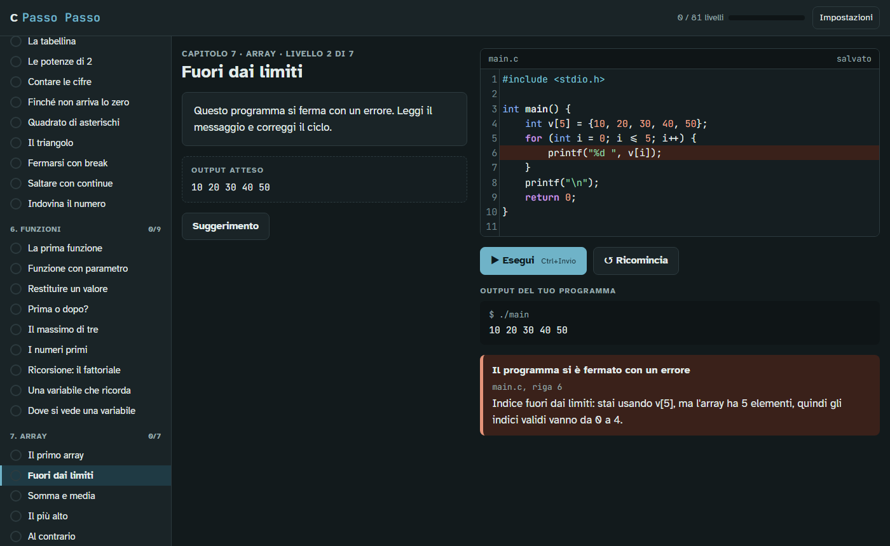

# Passo Passo — il C un passo alla volta

[English](README.md) · **Italiano**

Impara a programmare un piccolo passo alla volta, direttamente nel browser.
Ogni livello chiede una piccola modifica a un vero programma C: lo esegui, vedi cosa stampa e un
controllo automatico ti dice se è giusto, spiegando ogni errore con parole semplici.



## Caratteristiche

- **81 livelli in 12 capitoli**: primi programmi, variabili, tipi di dato, decisioni, cicli, funzioni,
  array, stringhe, puntatori, memoria dinamica, strutture e preprocessore.
- **Niente da installare**: è una pagina web statica. Il codice gira nel browser e non ne esce.
- **Errori spiegati per chi comincia**, con la riga giusta evidenziata:
  *"La funzione 'printt' non esiste. Forse volevi scrivere 'printf'?"*,
  *"scanf ha bisogno dell'indirizzo della variabile: hai dimenticato la & davanti a n?"*.
- **Gli errori di memoria diventano spiegazioni**: indici fuori dai limiti, variabili non inizializzate,
  uso dopo `free` e memoria non liberata vengono riconosciuti e spiegati, dove un vero programma C
  spesso sbaglierebbe in silenzio.
- **Controlli che non si aggirano** stampando la risposta: i livelli rieseguono il programma con
  input o valori iniziali diversi, e possono richiedere costrutti precisi (un ciclo, la ricorsione, `free`...).
- **Italiano e inglese**, per l'interfaccia, i livelli e i messaggi d'errore.
- **Leggibile e accessibile**: carattere Atkinson Hyperlegible, dimensione del testo regolabile,
  tema chiaro e scuro, tutto usabile da tastiera (`Ctrl+Invio` esegue il programma).
- **Progressi salvati** nel browser.

## Per iniziare

Clona o scarica il repository e apri `index.html` nel browser. Tutto qui.

I caratteri e l'editor del codice ([CodeMirror 5](https://codemirror.net/5/)) arrivano da una CDN;
senza connessione la pagina funziona lo stesso, con i caratteri di sistema e una semplice casella di testo come editor.

Parametri facoltativi nell'URL:

| Parametro | Esempio | Effetto |
|---|---|---|
| `locale` | `index.html?locale=it` | lingua dell'interfaccia e del corso (`en`, `it`) |
| `language` | `index.html?language=c` | linguaggio di programmazione del corso (oggi solo `c`) |

## Come funziona

I programmi C sono eseguiti da un interprete scritto in JavaScript per questo corso
(`src/languages/c/interpreter.js`): un preprocessore, un parser a discesa ricorsiva e una macchina
che esegue l'albero sintattico su una memoria simulata byte per byte (dati, stack e heap). Supporta
il sottoinsieme del C che serve al corso; i costrutti che non supporta (`union`, puntatori a
funzione, `goto`, compound literal, inizializzatori `.campo =`) vengono segnalati con un messaggio chiaro.

Ogni livello dichiara l'output atteso, gli input di prova e i controlli sul codice; il checker
(`src/core/checker.js`) ci confronta il programma dello studente.

Più dettagli in [docs/interprete.md](docs/interprete.md).

## Struttura del progetto

```
index.html                    la pagina: markup e script, nessuna build
css/app.css                   stile
src/core/                     interfaccia e checker, indipendenti dal linguaggio
src/i18n/                     testi dell'interfaccia (en è il riferimento, it)
src/languages/c/              il corso di C
  interpreter.js              l'interprete C
  language.js                 come il corso si collega all'interfaccia
  locales/<lingua>/           strings.js (messaggi) e levels.js (livelli) per ogni lingua
tests/                        test (node:test)
docs/                         documentazione
```

## Sviluppo

Requisiti: [Node.js](https://nodejs.org) 20 o successivo, solo per i test. Non ci sono dipendenze
da installare né passaggi di build.

```sh
npm test
```

I test controllano che ogni livello, in ogni lingua, sia superato dalla sua soluzione e non dal codice
di partenza; che ogni traduzione abbia le stesse chiavi e gli stessi segnaposto dell'inglese; i
comportamenti principali dell'interprete; e che `index.html` carichi ogni file sorgente.

Le regole del progetto (per persone e agenti di programmazione) sono in [AGENTS.md](AGENTS.md).
Il principio guida: scrivere solo quello che serve, riusare quello che il browser e il progetto offrono
già, e non risparmiare mai su messaggi d'errore, accessibilità, progressi salvati degli studenti e sicurezza.

## Contribuire

| Vuoi... | Leggi |
|---|---|
| tradurre il corso in una nuova lingua | [docs/adding-a-language.md](docs/adding-a-language.md) (in inglese) |
| aggiungere o modificare livelli | [src/languages/README.md](src/languages/README.md) |
| aggiungere un linguaggio di programmazione (Python, Rust...) | [docs/interprete.md](docs/interprete.md) |

Prima di aprire una pull request, esegui `npm test` e prova la modifica nel browser.

## Licenza

[MIT](LICENSE)
