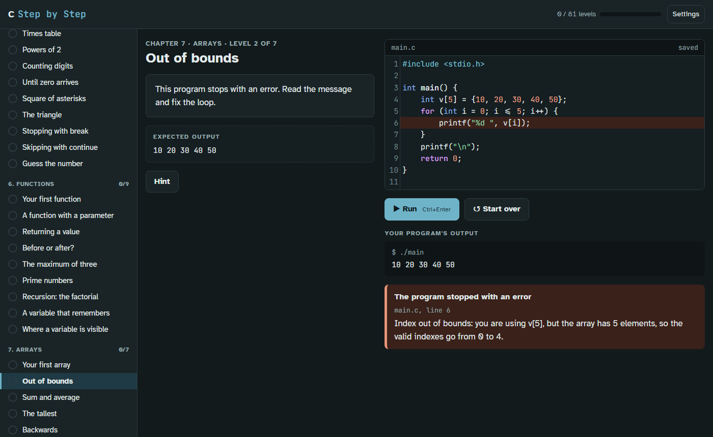

# C Passo Passo — C Step by Step

**English** · [Italiano](README.it.md)

Learn to program one small step at a time, right in the browser.
Each level asks for a small change to a real C program: you run it, see its output, and an
automatic check tells you whether it is right, explaining any mistake in plain language.



## Features

- **81 levels in 12 chapters**: first programs, variables, data types, decisions, loops, functions,
  arrays, strings, pointers, dynamic memory, structs and the preprocessor.
- **Nothing to install**: it is a static web page. The code runs in the browser and never leaves it.
- **Errors explained for beginners**, with the right line highlighted:
  *"The function 'printt' does not exist. Did you mean 'printf'?"*,
  *"scanf needs the address of the variable: did you forget the & in front of n?"*.
- **Memory mistakes become explanations**: out-of-bounds indexes, uninitialized variables, use after
  `free` and memory leaks are caught and explained, where a real C program would often fail silently.
- **Checks that cannot be fooled** by printing the answer: levels re-run your program with different
  input or starting values, and can require specific constructs (a loop, recursion, `free`...).
- **Italian and English**, for the interface, the levels and the error messages.
- **Readable and accessible**: Atkinson Hyperlegible font, adjustable text size, light and dark theme,
  full keyboard use (`Ctrl+Enter` runs the program).
- **Progress saved** in the browser.

## Quick start

Clone or download the repository and open `index.html` in a browser. That's it.

The fonts and the code editor ([CodeMirror 5](https://codemirror.net/5/)) are loaded from a CDN;
without a connection the page still works, with system fonts and a plain text box as editor.

Optional URL parameters:

| Parameter | Example | Effect |
|---|---|---|
| `locale` | `index.html?locale=en` | interface and course language (`en`, `it`) |
| `language` | `index.html?language=c` | programming language of the course (today only `c`) |

## How it works

The C programs are run by an interpreter written in JavaScript for this course
(`src/languages/c/interpreter.js`): a preprocessor, a recursive-descent parser and a tree-walking
machine with a simulated byte-addressed memory (data, stack and heap). It supports the subset of C
the course needs; constructs it does not support (`union`, function pointers, `goto`, compound
literals, designated initializers) are reported with a clear message.

Each level declares its expected output, its test inputs and its checks on the code; the checker
(`src/core/checker.js`) runs the student's program against them.

More details (in Italian) in [docs/interprete.md](docs/interprete.md).

## Project structure

```
index.html                    the page: markup and scripts, no build step
css/app.css                   styles
src/core/                     language-independent interface and checker
src/i18n/                     interface texts (en is the reference, it)
src/languages/c/              the C course
  interpreter.js              the C interpreter
  language.js                 how the course plugs into the interface
  locales/<locale>/           strings.js (messages) and levels.js (levels) for each language
tests/                        tests (node:test)
docs/                         documentation
```

## Development

Requirements: [Node.js](https://nodejs.org) 20 or newer, only to run the tests. There are no
dependencies to install and no build step.

```sh
npm test
```

The tests check that every level, in every language, is solved by its solution and not by its
starting code; that every translation has the same keys and placeholders as English; the main
behaviours of the interpreter; and that `index.html` loads every source file.

The project rules (for people and AI coding agents) are in [AGENTS.md](AGENTS.md), in Italian.
The guiding principle: write only what is needed, reuse what the browser and the project already
offer, and never cut corners on error messages, accessibility, students' saved progress or security.

## Contributing

| You want to... | Read |
|---|---|
| translate the course into a new language | [docs/adding-a-language.md](docs/adding-a-language.md) |
| add or change levels | [src/languages/README.md](src/languages/README.md) (Italian) |
| add a programming language (Python, Rust...) | [docs/interprete.md](docs/interprete.md) (Italian) |

Before opening a pull request, run `npm test` and try your change in the browser.

## License

[MIT](LICENSE)
